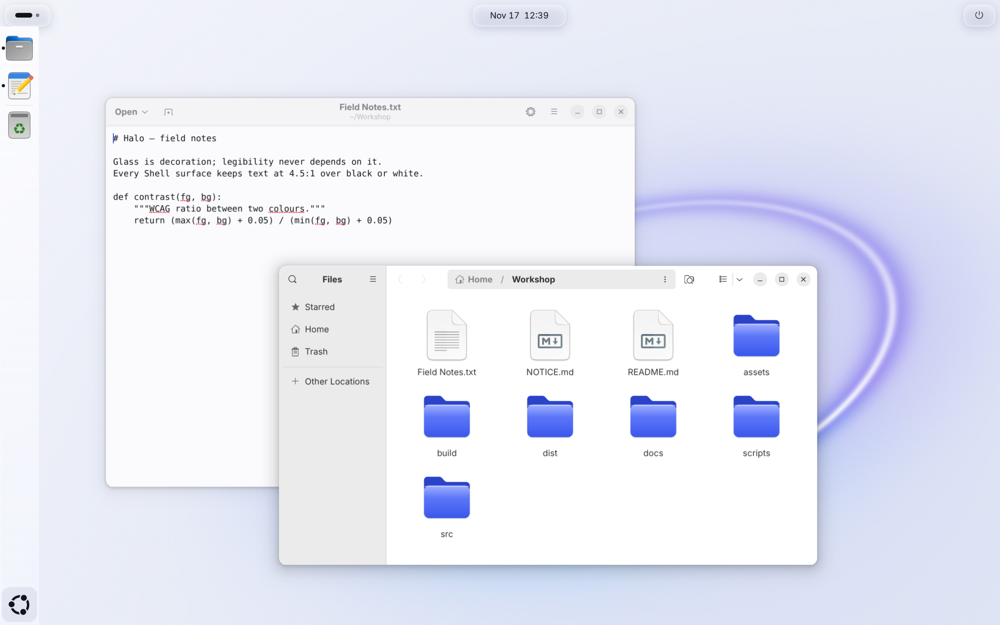
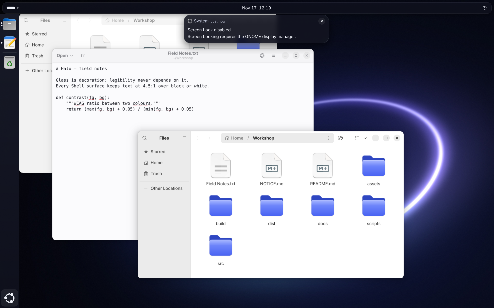

# Halo

A clear-glass theme for GNOME 50, built for Ubuntu 26.04. The top bar is three floating islands of glass (Activities, clock, system controls). The dock, menus, Quick Settings, calendar, notifications, dialogs and switchers share one material: a tinted plane with a light-catching rim and a soft shadow. A cobalt accent marks active controls. Apps get flat header bars, a tinted sidebar, rounded selections and 16 px window corners.

Glass is decoration; legibility never depends on it. Every Shell surface is tinted so text keeps at least 4.5:1 contrast over pure black and pure white, even with no blur. If [Blur my Shell](https://extensions.gnome.org/extension/3193/blur-my-shell/) is installed, Halo configures it to blur what sits behind each surface.




## What you get

- Light and dark variants of the Shell, GTK 3, GTK 4 and (optionally) libadwaita styling
- A small companion extension, Halo Glass, that gives each panel island its own blur
- Folder icons (Halo-Light / Halo-Dark) that sit over whichever icon theme you already use
- Matching wallpapers, a Ptyxis terminal palette and Text Editor colour schemes
- An optional GDM login screen style (needs sudo)
- Every setting Halo changes is recorded, and `./scripts/theme restore` puts it back

## Install

Requirements: GNOME Shell 50 (Ubuntu 26.04), Python 3 with PyGObject (NumPy and Pillow only if you regenerate the wallpapers with `scripts/halo-art`), and the [User Themes](https://extensions.gnome.org/extension/19/user-themes/) extension for Shell styling. Blur my Shell is optional.

```sh
git clone https://github.com/trilloc/halo.git
cd halo
./scripts/build --family halo
./scripts/theme install
./scripts/theme apply dark --wallpaper --adwaita
./scripts/theme apply light
./scripts/theme status
```

Log out and back in once after the first install so GNOME Shell loads the Halo Glass extension. To go back:

```sh
./scripts/theme restore     # return your previous settings
./scripts/theme uninstall   # restore, then remove Halo's files
```

Nothing is installed system-wide, except the optional login screen. See [docs/halo.md](docs/halo.md) for all options (`--no-blur`, `--floating-dock`, `--no-apps`, the login screen, how the tint adapts to your wallpaper, and the validation notes).

## Status

- Developed and used daily on Ubuntu 26.04 with GNOME Shell 50 on Wayland.
- The published screenshots and automated visual checks were produced in a disposable GNOME Shell 46 session. Run `./scripts/visual-qa/run /tmp/halo-review all halo` to repeat them on your own system.
- The login screen style has been exercised against Ubuntu's alternatives system but the greeter itself has not been seen on a running GDM. If it looks wrong, switch to a text console and run `sudo ./scripts/halo-login restore`.
- GNOME versions other than 50, X11 sessions and other distributions are untested. Issues and pull requests are welcome.

## Licence

MIT, see [LICENSE](LICENSE). Third-party notes are in [NOTICE.md](NOTICE.md).
